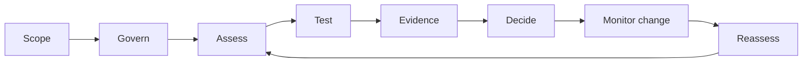

# Welcome to Assurio

> AI governance, risk and assurance documentation

Assurio brings AI inventory, risk and impact assessment, test and evaluation evidence, human review, and accountable approval decisions into a connected assurance record. It is intended for organizations governing **AI models, AI agents, and adaptive or autonomous systems**.

> **Documentation status:** This guide is a detailed product-documentation draft based on Assurio's published platform description (reviewed November 4, 2026). Workflows and record examples explain the intended operating model. Exact navigation labels, deployment settings, API routes, plan entitlements, and user permissions require validation in your Assurio environment before external publication.

## Where to start

| Start here | You will learn | Who it's for |
| --- | --- | --- |
| [Getting started](documentation/getting-started/README.md) | Prepare an initial assurance record and understand the lifecycle | New users and system owners |
| [Quickstart](documentation/getting-started/quickstart.md) | Complete a first, illustrative governance-to-decision review | Teams running a pilot |
| [Core concepts](documentation/core-concepts/README.md) | Systems, baselines, risks, evidence, findings and decisions | Everyone |
| [Guides](documentation/guides/README.md) | Detailed procedures for common assurance tasks | Governance and TEVV practitioners |
| [Reference](documentation/reference/README.md) | Field definitions, traceability, policy mappings and checklists | Reviewers and auditors |
| [API reference](api-reference/README.md) | Integration principles and API specification requirements | Developers and integrators |
| [Changelog](changelog/README.md) | How product changes and release notes are published | All users |
| [Help center](help-center/README.md) | Common questions, diagnostics and support preparation | All users |

## The connected assurance lifecycle

1. **Scope:** identify the AI system, components, intended uses, exclusions, and operating conditions.
2. **Govern:** assign accountable owners, review authority, permissions, and controls.
3. **Assess:** evaluate harms, likelihood and severity, dependencies, and residual exposure.
4. **Test:** validate claims against measurable criteria through appropriate TEVV activities.
5. **Evidence:** preserve source, version, environment, methodology, reviewer and results.
6. **Decide:** make a bounded approval, conditional approval, restriction, or rejection by the authorized human role.
7. **Monitor change:** detect differences affecting approved configurations, policies or environments.
8. **Reassess:** reopen affected claims, refresh evidence, and document a revised decision.

## What Assurio does — and does not — establish

Assurio is designed to organize governance and assurance evidence; it is **not** an automatic safety certification, universal regulatory compliance determination, or substitute for human acceptance authority. The approval is only as defensible as the tested scope, quality of evidence, policies, and accountable review behind it.

## Roles that typically use this documentation

- **Business/system owner:** describes use, impact, operating boundaries, and business accountability.
- **Governance/risk lead:** sets required controls, risk review, and escalation.
- **TEVV lead/evaluator:** defines tests, collects results, records limitations.
- **Independent reviewer:** assesses evidence sufficiency and contradictions.
- **Acceptance authority:** makes a documented decision within delegated authority.
- **Platform/integration administrator:** configures access, evidence ingestion, and operational processes.

**Official product:** https://sdlccorp.com/products/assurio/
