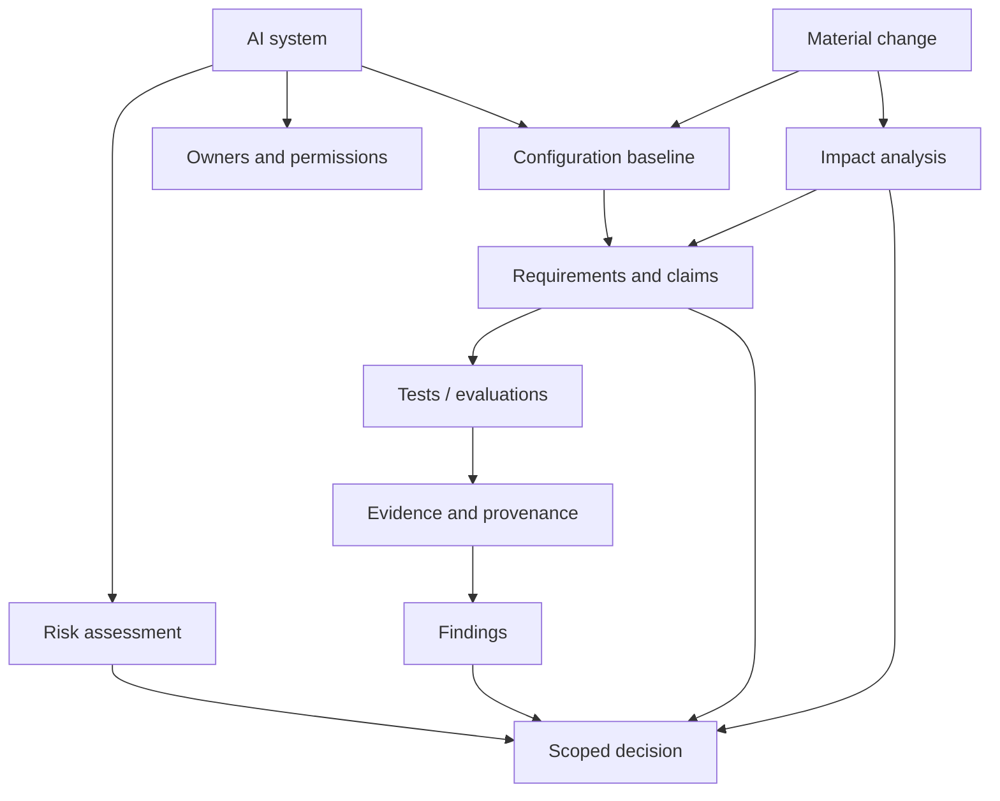

# Core concepts

> Learn the data and governance concepts underlying Assurio

Assurio organizes an assurance decision around a **system**, rather than around a model score alone. The same model can carry different risks depending on its data access, connected tools, audience, operating domain and human oversight.

## Concept map

## Read the concepts

- [Organizations, scopes and projects](workspaces-projects.md)
- [Roles and permissions](roles-permissions.md)
- [Systems and baselines](systems-baselines.md)
- [Requirements and claims](requirements-claims.md)
- [Risk and controls](risk-and-controls.md)
- [TEVV, evidence and findings](tevv-evidence-findings.md)
- [Decisions and changes](decisions-change.md)

## Three distinctions worth preserving

**Model vs. system:** a model is one component; the system includes data, prompts, tools, orchestration, interfaces and people.

**Test result vs. evidence:** a result reports an observation; an evidence record includes how, where, when and against which baseline it was obtained.

**Score vs. decision:** a score may inform evaluation; a human decision defines authorized operating scope and conditions.
