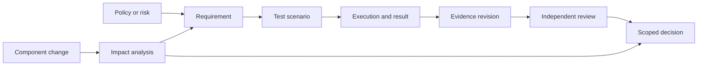

# Traceability and lineage

> Reconstruct the reasoning behind every acceptance decision

The core assurance link is not a dashboard score. It is a navigable chain from an operating claim to the evidence and human decision that relies on it.

## Minimal traceability row

| Column | Example |
| --- | --- |
| `baseline_id` | BASE-042-2026-11 |
| `requirement_id` | REQ-003 |
| `risk_id` | R-03 |
| `test_run_id` | RUN-220 |
| `evidence_id` | EVD-017 |
| `finding_id` | FIND-011 or `none` |
| `review_status` | pending / adequate / inadequate (example) |
| `decision_id` | DEC-009 |

## Quality checks

- A critical requirement should never appear satisfied merely because its evidence link is empty.
- Evidence collected on a different baseline must disclose the difference and its relevance.
- Changes should show what evidence they affect, including a rationale for unaffected items.
- A finding must trace to observations, not only to a narrative assertion.
- The authorization record must retain the person and scope of authority making the decision.

## Reconstructed reviewer question

“Why was the assistant allowed to provide answers for employees but not contractors?” The chain should reveal the scoped user population, failed access test, relevant finding, restriction control and reviewer decision—not just a date and a green status.
